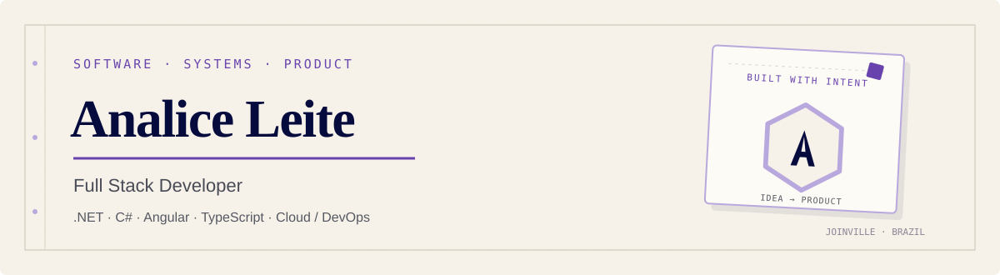

  

 

I started in tech as an apprentice and grew into an analyst. Today, I work at **Bosch Service Solutions**, building across the stack and learning how good engineering decisions hold up in real products.

I care about the whole path: understanding the problem, shaping the system, shipping it, and making it easier to evolve. Alongside my work, I'm pursuing an MBA in **Software Architecture** at Full Cycle.

### From the workbench

**[Worship Flow](https://github.com/analiceleite/worship_flow)** · *In use*

I conceived, designed, built, deployed, and maintain this product for worship teams. It brings songs, service schedules, roles, and reminders into one workflow. [Explore the demo](https://worship-flow-kappa.vercel.app/).

**[Crissia](https://github.com/analiceleite/crissia)** · *Working demo*

A multi-tenant management product for thrift stores. I built it end to end, connecting inventory, sales, and shopping bags; the portfolio has a [demo to explore](https://crissia.site).

**[SecureOps Lab](https://github.com/analiceleite/secure_ops_lab)** · *Local lab*

A security and operations learning project exploring MFA, access control, monitoring, and AI-assisted incident reports. It's a local proof of concept, not a production security platform.

### At my desk

`.NET` · `C#` · `Angular` · `TypeScript` · `GCP` · `Kubernetes` · `Terraform` · `PostgreSQL`

I also keep **Engineering Notes** on software architecture, system design, and the decisions that help software evolve. They're part of my [portfolio](https://analice-dev.vercel.app/).

---

**Find me elsewhere:** [Portfolio](https://analice-dev.vercel.app) · [LinkedIn](https://www.linkedin.com/in/analice-leite) · [Email](mailto:analice.leite12@gmail.com)

Joinville, Brazil

