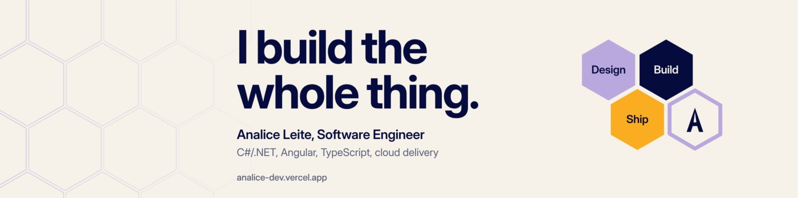

  

 

### Behind the work

I'm Analice, a Full Stack Developer at **Bosch Service Solutions**. My work spans interfaces, backend systems, and cloud delivery. In my own products, I take that further: from the first design decision to deployment and maintenance.

I started in tech as an apprentice and grew into an analyst. Alongside my work, I'm pursuing an MBA in **Software Architecture** at Full Cycle.

### Things I've built

**[Worship Flow](https://github.com/analiceleite/worship_flow)** · *In use*

I conceived, designed, built, deployed, and maintain this product for worship teams, bringing songs, service schedules, roles, and reminders into one workflow.

One decision behind it: publishing a schedule requires server-side checks of the administrator's role and church context; email reminders are tracked separately through persisted notification attempts.

[Explore the demo](https://worship-flow-kappa.vercel.app/)

**[Crissia](https://github.com/analiceleite/crissia)** · *Working demo*

A management product I built for thrift stores, connecting inventory, sales, and shopping bags.

One decision behind it: protected server routes derive the store's tenant context from the authenticated user and explicitly scope privileged queries to that tenant, rather than trusting browser-side filters.

[Explore the demo](https://crissia.site)

### What I'm exploring

**[SecureOps Lab](https://github.com/analiceleite/secure_ops_lab)** · *Local lab*

A security and operations learning project exploring MFA, access control, monitoring, and AI-assisted incident reports. It's a local proof of concept, not a production security platform.

**Engineering Notes**

My study notes on software architecture, system design, and the decisions that help software evolve live in my [portfolio](https://analice-dev.vercel.app/).

### Tools I work with

`.NET` · `C#` · `Angular` · `TypeScript` · `GCP` · `Kubernetes` · `Terraform` · `PostgreSQL`

---

**Find me elsewhere:** [Portfolio](https://analice-dev.vercel.app) · [LinkedIn](https://www.linkedin.com/in/analice-leite) · [Email](mailto:analice.leite12@gmail.com)

Joinville, Brazil

