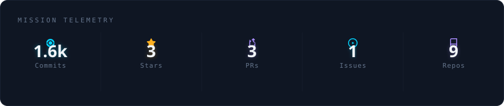

<!-- Galaxy Profile README Template
     Customize this file with your own info, then rename it to README.md
     in your GitHub profile repo (github.com/YOUR_USERNAME/YOUR_USERNAME).
     The SVG paths below point to assets/generated/ which are auto-generated
     by the GitHub Actions workflow or by running: python -m generator.main -->

  

 

  

 

  

 

  

 

<strong>More about me</strong>

 

Full Stack Developer focused on .NET, Angular, backend architecture, Cloud/DevOps,
and AI-assisted automation. I work on enterprise platforms and production-ready
products with C#, TypeScript, GCP, Kubernetes, Terraform, CI/CD, Clean Architecture,
DDD, and technical quality practices.

My goal is to grow into a strong mid-level (Pleno) developer role by building
useful, reliable, and scalable software. I also develop real products such as
Crissia, Worship Flow, FocusFlow, and DBMind Agent.

Degree in Systems Analysis and Development and currently pursuing a Lato Sensu
MBA in Software Architecture at Full Cycle.

**Currently at** Bosch Service Solutions — Joinville, SC

 

  
  
  

